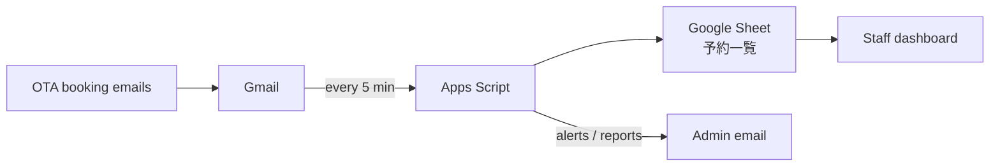

# Booking Manager (Kushi Base)

A Google Apps Script system that collects bookings from multiple OTA emails into one Google Sheet and shows them on a staff dashboard.

Built for three experience brands in Kyoto and Osaka: EN (chopsticks, kintsugi, knife making), MUSUBI (coin rings) and INSIDE SUMO KYOTO (sumo show).

## What it does

- Reads booking emails from Gmail every 5 minutes and writes them to a Google Sheet
- Applies date changes, partial cancellations and cancellations to the same booking row
- Shows a password-protected dashboard (web app) by shop, date and time slot
- Lets staff record arrival, phone call, payment, staff in charge, review and memo
- Lets staff register walk-in bookings by hand
- Detects guest country from passport info (Klook) or phone country code
- Sends capacity alerts: over 25 guests per hour (Kyoto / Osaka), 70+ per sumo show
- Rechecks recent emails every 2 hours and audits all future bookings nightly
- Builds a daily timeline sheet and an analytics sheet every morning

## Supported booking channels

| Channel | Booking ID format |
| --- | --- |
| Klook | 3 letters + 6 digits (e.g. `ABC123456`) |
| Bokun (Viator, TripAdvisor) | `KAK-...` |
| GetYourGuide | `GYG...` |
| Japan ticket (Klook / KKday for Kyoto MUSUBI) | `JT-...` (generated) |
| Own website (EN booking form, Square) | `EN-...` / `SQ-...` (generated) |
| Walk-in (entered on dashboard) | `WALK-...` (generated) |

## How it works

Processed emails get the Gmail label `Klook/処理済み_COPY`, so each email is handled once. The 2-hourly recheck and the nightly audit ignore the label and catch anything that was missed, including change or cancellation emails that arrive in an already-processed thread.

## Files

| File | Purpose |
| --- | --- |
| `Code.gs` | All server logic: email parsing, sheet writes, triggers, alerts, dashboard API |
| `dashboard.html` | Staff dashboard UI (served by `doGet`) |

## Setup

1. Create a Google Sheet and an Apps Script project (Extensions → Apps Script).
2. Add `Code.gs` and `dashboard.html`.
3. In `Code.gs`, fill in the settings at the top:
   - `CONFIG.SPREADSHEET_ID`: ID of your Google Sheet
   - `CONFIG.GMAIL_QUERY`: senders to read
   - `ALERT_EMAILS`, `SUMO_ALERT_EMAILS`: who receives alerts
4. Set the dashboard password: type it into `NEW_PASSWORD` in `setDashboardPassword()`, run it once, then clear it and save. The password is stored in Script Properties, not in the code.
5. Run `setupTriggers()` once.
6. Run `トリガーを確認()` and check that all 6 triggers show ✅.
7. Deploy as a web app: Deploy → New deployment → Web app. Staff use the `/exec` URL.

After any code change, publish a new version (Deploy → Manage deployments → Edit → New version) so the `/exec` URL is updated. Triggers always run the latest saved code.

## Scheduled jobs

| Function | When | What it does |
| --- | --- | --- |
| `processKlookEmails` | Every 5 min | Processes new booking emails |
| `syncRecentEmails` | Every 2 hours | Rechecks the last 3 days of email |
| `checkHourlyCapacity` | Every hour | Sends capacity alerts (skips slots that have started) |
| `generateDailyTimeline` | 7:00 daily | Rebuilds today's timeline sheet |
| `updateAnalytics` | 7:00 daily | Updates nationality, lead time and cancellation stats |
| `未来予約の監査` | 3:00 daily | Adds any future booking found in email but missing from the sheet, then emails a report |

## Sheet columns (`予約一覧`)

| Columns | Content | Written by |
| --- | --- | --- |
| A–J | Date, time, course, guests, name, booking ID, status, received at, channel, previous date/time | Script |
| K–P | Paid, staff, review, memo, arrived, called | Dashboard |
| Q–S | Phone, country, email | Script |
| T | Shop (京都 / 大阪 / 相撲) | Script |

Do not sort, delete or move rows or columns in this sheet by hand. Use filters instead.

## Maintenance tools (run manually)

| Function | Use |
| --- | --- |
| `トリガーを確認` | Check that all triggers exist, with no duplicates |
| `診断` | Show sheet size, unprocessed email count and triggers |
| `取りこぼしを30日分チェック` | Recheck the last 30 days of email |
| `予約番号を再処理する` | Reprocess specific booking IDs (edit `ids` first) |
| `Klookの誤キャンセルを直す` | Restore Klook date changes that were marked as cancelled |
| `人数0の予約を直す` | Fill in guest counts showing 0 |
| `重複を完全に削除` | Remove duplicate rows |
| `JapanTicketをテスト` | Check Japan ticket email parsing |

## Known limitations

- Japan ticket and Square emails have no real booking ID, so their cancellations can't be matched to the original booking automatically.
- Japan ticket emails have no guest name or phone number.
- Square emails have no guest count; bookings are saved as 1 guest.
- Shop detection relies on the words 大阪 / Osaka in the email.

## Security

- Do not commit real spreadsheet IDs, email addresses or passwords. Keep them out of the public repo.
- Limit edit access to the Apps Script project. Anyone with edit access can delete the code and triggers.
- Keep a backup copy of `Code.gs` and `dashboard.html` after each working change.
